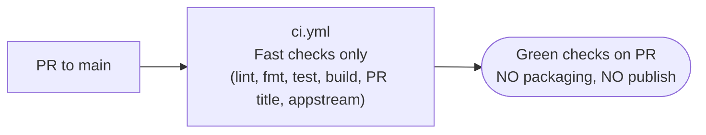
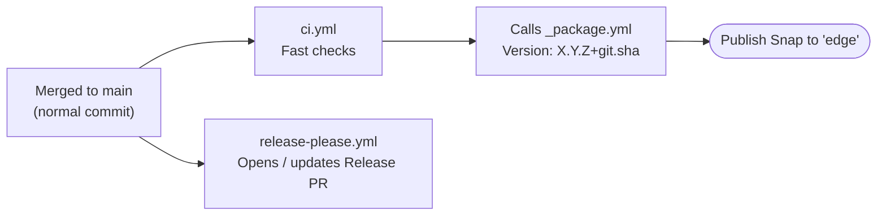
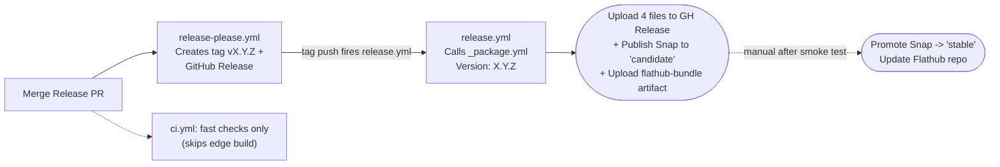
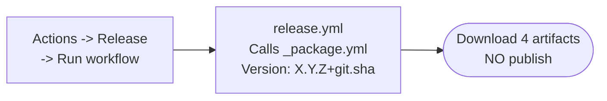
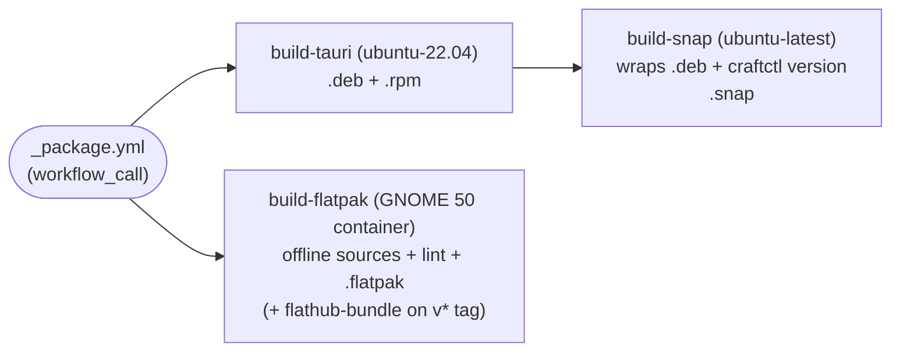

# Capturist CI/CD Flow

> Companion reference for `.github/workflows/` and `.github/actions/`. Three thin trigger workflows delegate all packaging to one shared reusable workflow (`_package.yml`); only Snap `stable` promotion and Flathub repo updates are manual.

### 1. Open / Update a PR (before merge)

### 2. Merge a normal PR into `main`

### 3. Merge the `release-please` PR (real release)

### 4. Manual packaging test (on-demand, any branch)

### Shared `_package.yml` (called by lanes 2, 3, and 4)

## Workflow roles

| Workflow             | Trigger                                    | Purpose                                                                                                                                                                                                                                                       |
| -------------------- | ------------------------------------------ | ------------------------------------------------------------------------------------------------------------------------------------------------------------------------------------------------------------------------------------------------------------- |
| `ci.yml`             | PR and `main` push                         | Fast quality gates (`frontend` lint/format/test/build, `backend` fmt/clippy/test, semantic PR title check, `appstreamcli`). On normal pushes to `main` (skipping `release-please` release commits), calls `_package.yml` and publishes `.snap` to **`edge`**. |
| `release-please.yml` | `main` push                                | Derives the next version from Conventional Commits, opens/maintains a release PR (`package.json`, `Cargo.toml`, `metainfo.xml`, `me.ariyadey.capturist.yml`), and on merge creates the `v*` tag + GitHub Release with release notes.                          |
| `release.yml`        | Manual `workflow_dispatch` **or** `v*` tag | Manual = calls `_package.yml` to build all 4 formats as downloadable artifacts (no publish). `v*` tag = calls `_package.yml` (with `flathub-bundle`), attaches all 4 formats to the GitHub Release, and publishes `.snap` to **`candidate`**.                 |
| `_package.yml`       | Reusable (`workflow_call`)                 | Single source of truth for building `.deb`, `.rpm`, `.snap` (version overridden via `craftctl` when `snap-version.txt` is present), and `.flatpak` (with offline sources + `flatpak-builder-lint`).                                                           |

## Shared composite actions

| Action                     | Role                                                                              |
| -------------------------- | --------------------------------------------------------------------------------- |
| `generate-flatpak-sources` | Regenerates offline `flatpak/cargo-sources.json` and `flatpak/node-sources.json`. |

## Snap Store channels

| Channel     | Content                                              | When                                                                           |
| ----------- | ---------------------------------------------------- | ------------------------------------------------------------------------------ |
| `edge`      | Every merged `main` commit, unique version per build | Automatic, **only on normal merge to `main`** (never on PRs)                   |
| `candidate` | Release candidate built from a `v*` tag              | On `v*` tag push                                                               |
| `stable`    | The tested release                                   | Manually promoted (`snapcraft promote capturist --from candidate --to stable`) |

## Release process (one sentence)

Optionally test packages via _Actions → Release → Run workflow_, merge Conventional-Commits PRs to `main`, merge the `release-please` PR (creates `v*` tag + GitHub Release + assets + Snap `candidate` + `flathub-bundle` artifact), then promote `candidate → stable` after smoke testing and copy `flathub-bundle` into the Flathub repo.

## Secrets used

- `SNAPCRAFT_STORE_CREDENTIALS` — Snap Store publishing (`edge`/`candidate`).
- `RELEASE_PLEASE_TOKEN` — a fine-grained PAT (`Contents: write`, `Pull requests: write`); required so the tag `release-please` creates can trigger `release.yml`.
